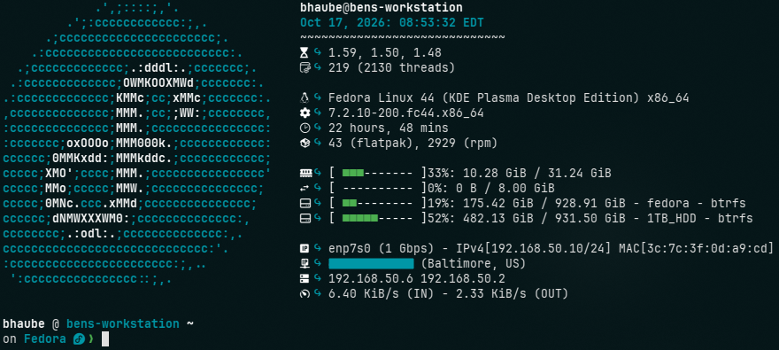
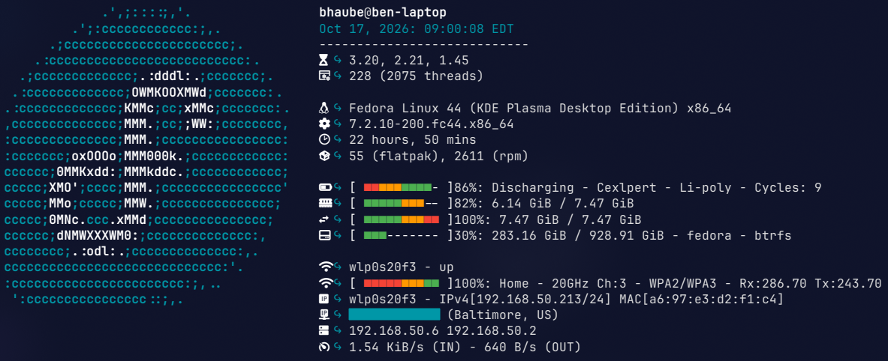
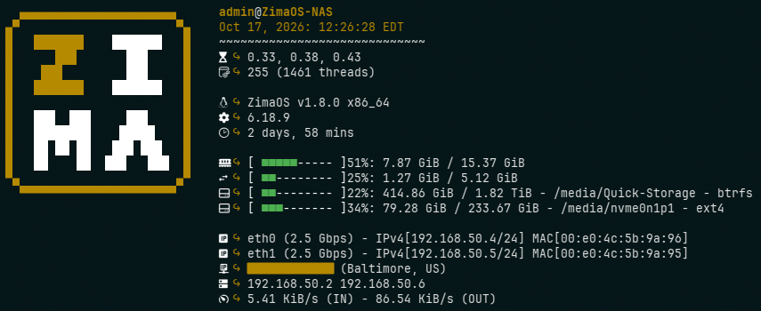
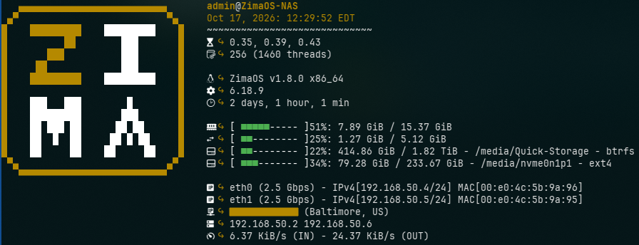

<p align="center">
    
</p>
<p>
<h1 align="center">
    Fastfetch Login Preset
</h1>
</p>

### About

This is a preset for Fastfetch that is intended to run on login when you open a terminal, or login to your server over SSH. It shows relevant system information and an ASCII logo of your operating system. 

> [!note]
> *You can change the colors of the presets to match your distribution. Currently, they are cyan to match fedora.*
> 
> *This preset requires a [Nerd Font](https://www.nerdfonts.com/) to be installed and set in your terminal to properly display the icons.*
> 
> *If you are using a mobile device (such as a laptop) you can use the `login-mobile.jsonc` preset instead to show power adaptor and battery information.*
> 
> *If your computer does not have an active Wi-Fi connection you can use the `login-no-wifi.jsonc` preset.*

### Screenshots

<p align=center>
    
    
    
    
</p>

### Install

1. Clone the Github repository:

    ```Bash
    git clone https://github.com/benhaube/fastfetch-login-preset.git
    ```
2. Install `fastfetch` if you have not already:

    + Fedora/RHEL based distributions:

        ```Bash
        sudo dnf install fastfetch
        ```
    + Debian/Ubuntu based distributions:

        ```Bash
        sudo apt install fastfetch
        ```
    + Visit the `fastfetch` [Github](https://github.com/fastfetch-cli/fastfetch.git) repository if it is not available in your distribution's package manager. 

3. Backup your `.bashrc` file in case you make a mistake:

    ```Bash
    cp .bashrc .bashrc.bkp
    ```

4. Enter the project directory:

    ```Bash
    cd fastfetch-login-preset/
    ```

5. Copy the file `login.jsonc` to the `/usr/share/fastfetch/presets/` directory and confirm fastfetch can see the preset:

    ```Bash
    sudo cp login.jsonc /usr/share/fastfetch/presets/
    fastfetch --list-presets
    ```
6. Go back to your `/home/user/` directory and edit the `.bashrc` file to add the `fastfetch` command:

    ```Bash
    cd
    nano .bashrc
    ```
7. Add the following to the end of your `.bashrc` file:

    ```Bash
    # Run the fastfetch command with the login.jsonc profile at login to show relavant system information
    fastfetch -c login
    ```
8. `Ctrl+O` and `Enter` to save the changes and `Ctrl+X` to close the file

Now you should be able to open a new terminal window or tab and see the `fastfetch` command run with the `login.jsonc` profile before you get your terminal prompt. 
